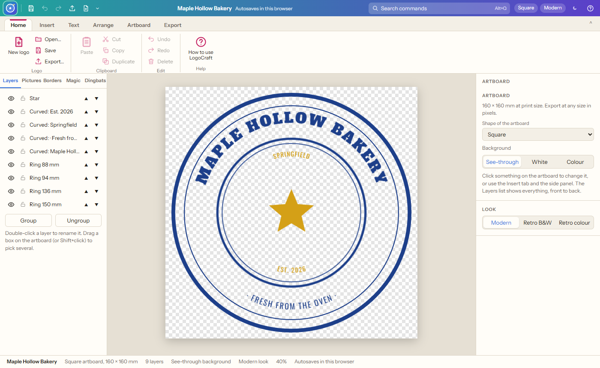
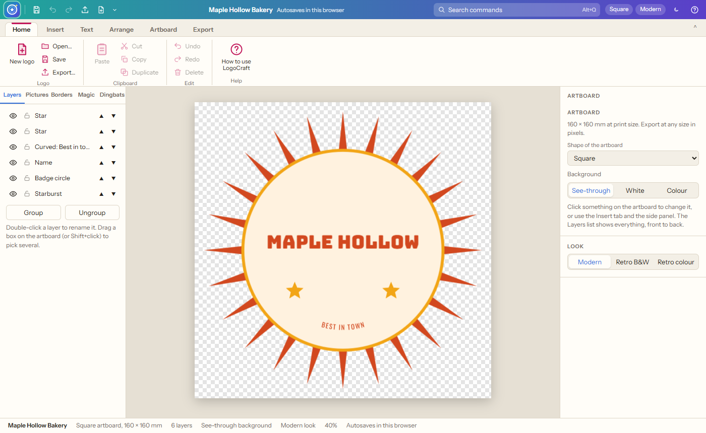
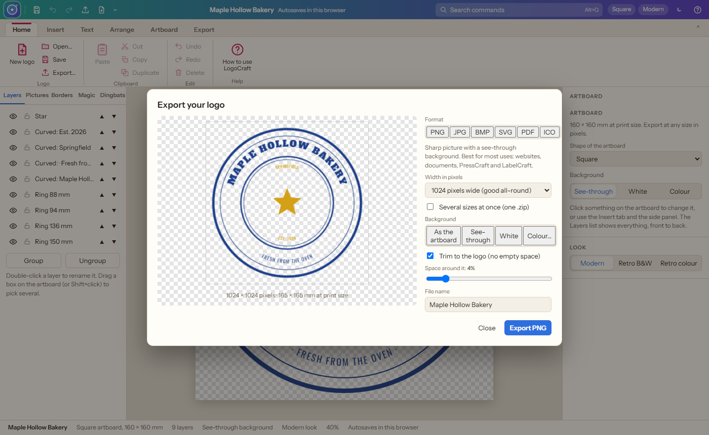
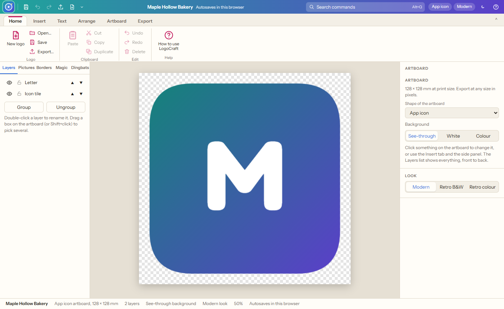

# LogoCraft

**Logos, seals, stamps, badges, emblems, wordmarks, monograms and app icons in your browser, with layers, exported as PNG, JPG, BMP, SVG, PDF or ICO at any size.**

LogoCraft is a dedicated logo maker. Type your name, tagline, place and year, pick a colour set and a template, and change everything from there: curved text around rings, shapes with sharp or round corners, 3-D sides and three-line borders, titles with outlines and shadows, pictures, dingbats and patterns. Every piece is a layer you can hide, lock, rename, reorder, group and blend. Everything works offline from this folder. The logos it makes drop straight into PressCraft, LabelCraft, SiteCraft and DataCraft.

## Getting started

1. Download this repository (green **Code** button › **Download ZIP**) or clone it.
2. Double-click `index.html`. It opens in Chrome or Edge.
3. Choose a template (or a blank artboard), type your words and pick the colours and artboard shape.
4. Change anything you like, then **Export**.

Your logo autosaves in the browser; **Save** keeps a `.logocraft.json` file you can open again later.

## Finding your way

| Where | What is there |
| --- | --- |
| **LogoCraft logo** (top left) | Every command in classic menus: File, Edit, Insert, Arrange, Artboard, View, Help (also F10) |
| **Top bar** | Quick buttons (save, undo, redo, export, new logo), the logo name, **Search commands (Alt+Q)**, artboard, look, light/dark theme, help |
| **Ribbon tabs** | **Home**, **Insert** (titles, text, text boxes, pictures, borders, Screen Magic, shapes, seal rings, curved text, dingbats), **Text** (works like Word), **Arrange** (order, centring, group), **Artboard** (shape, background, modern or retro look, zoom), **Export** |
| **Left side** | **Layers**, **Pictures**, **Borders**, **Magic**, **Dingbats** |
| **Right side** | Everything about what you clicked: words, fonts, colours, curve, shape, opacity, blend mode, shadow… |

## What it does

### Templates

| Template | What you get |
| --- | --- |
| **Seal** | Two sets of rings with your name and tagline curved around the outside, place and year inside, a star in the middle |
| **Rubber stamp** | A tilted, rounded double frame with a bold word and small details |
| **Badge** | A starburst with a circle, your name, tagline and stars |
| **Emblem** | A shield with a star, your name and a ribbon banner |
| **Wordmark** | Your name in big letters, a rule and a spaced-out tagline |
| **Monogram** | Your initials in a three-line ring with curved words |
| **App icon** | A rounded square with a gradient and a letter |
| **Retro computer** | The 1980s dot-matrix look with a pixel font |

Six colour sets (navy and gold, red and black, forest, teal and purple, sunset, black ink) and five artboard shapes (square, wide, tall, long banner, app icon). The background is see-through unless you choose white or a colour.

### Layers

- Every object is a layer. The list shows them front to back.
- **Hide** (eye), **lock** (cannot be clicked or moved), **rename** (double-click), **move up or down**.
- **Group** and **ungroup** (Ctrl+G, Ctrl+Shift+G).
- Each layer has **opacity** and a **blend mode**: normal, multiply, screen, overlay, darken, lighten, colour dodge and burn, hard and soft light, difference, exclusion, hue, saturation, colour and luminosity.

### Export

| Format | Best for |
| --- | --- |
| **PNG** | Most uses. Keeps the see-through background. |
| **JPG** | Small files. The background is filled in. |
| **BMP** | Older Windows programs. The background is filled in. |
| **SVG** | Vector: sharp at any size, for printers, sign makers and cutters. |
| **PDF** | A one-page PDF the size of the logo (see-through kept). |
| **ICO** | Website and Windows icons: 16, 32, 48, 64, 128 and 256 pixels in one file. |

Choose any width from 16 to 4096 pixels (or type your own, up to 8000), or **several sizes at once** in one .zip. **Trim** removes the empty space around the logo, with as much space around it as you like. **Print** prints the artboard at its real size.

### The retro look

The Artboard tab switches between **Modern**, **Retro B&W** (dithered black dots) and **Retro colour** (an eight-colour ribbon). See-through areas stay see-through. PNG, JPG, BMP, PDF and ICO keep the dots; SVG saves the modern look.

## Objects and text (the same in every Craft app)

- **Opacity** on everything, **shadows**, rotation.
- **Shapes**: box, rounded box, circle, triangle, diamond, pentagon, hexagon, octagon, star, arrow and line, with sharp or round corners, words inside, **3-D** sides (face, side and edge colours) and **three border lines** (outer, middle, inner).
- **Text** like Word: fonts, bold, italic, underline, strikethrough, sub- and superscript, colours, highlight, outline, case, lists, spacing.
- **Curved text** around a circle, up or down, with rotation and spread.
- **Dingbats**: about 300 classic symbols, coloured and sized like text, with gradient or picture fills.

## Keyboard shortcuts

| Keys | What they do |
| --- | --- |
| Ctrl+N / Ctrl+O / Ctrl+S | New logo / open / save |
| Ctrl+E / Ctrl+P | Export / print |
| Ctrl+Z / Ctrl+Y | Undo / redo |
| Ctrl+X / C / V / D | Cut / copy / paste / duplicate |
| Ctrl+G / Ctrl+Shift+G | Group / ungroup |
| Arrows (Shift for 5 mm) | Nudge |
| + / − / 0 | Zoom in / out / fit |
| Alt+Q / F10 | Search commands / all menus |

## Requirements

A current Chrome, Edge or Firefox. No internet needed after downloading.

## Coming next

- **Phase 2:** turn a picture into an SVG logo (choose how many colours, or the best match), magic-wand selection to delete, fill or recolour areas, eraser and soft (anti-aliased) edges.
- **Phase 3:** pen tool and point editing, combining shapes (union, subtract, intersect), align and distribute.

## How this was made

This app is **vibe coded**: its author designed and directed it in plain conversation, feature by feature, and an AI coding assistant (Claude, by Anthropic) wrote the code.

It is a **genuine clean-room build**, not a decompiled or AI-rebuilt copy of anything:
- Nothing was decompiled, disassembled or reverse-engineered, in whole or in part.
- No code, artwork, fonts, icons or data files from any original program were used, and none were given to the AI to work from.
- LogoCraft is inspired by the general idea of logo and badge makers; only publicly known features and general ideas guided the design. Every line of code, template and picture here was made new.

Open-source libraries it uses are listed with their licences in Credits.

## Credits

- [Fabric.js](https://fabricjs.com) 5.3 (MIT) for the drawing canvas.
- Fonts from Google Fonts under the SIL Open Font License, stored in `fonts/`.
- Every template, picture, border and pattern here is original LogoCraft artwork.

## Development notes

How LogoCraft is built is described in [NOTES.md](NOTES.md).
